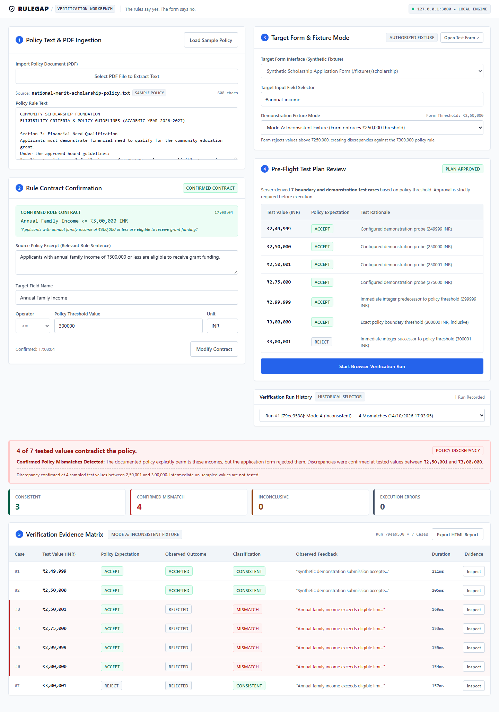

# RuleGap

> **"The rules say yes. The form says no."**

RuleGap is an open-source, local-first software consistency verifier. It detects, documents, and proves discrepancies between written policy guidelines (PDF or pasted text) and digital form validation logic through automated, black-box browser execution.



---

## The Problem

When institutions update grant limits, scholarship income thresholds, or regulatory policies, digital web forms frequently remain hardcoded with obsolete criteria. Eligible applicants are silently rejected without explanation, while compliance officers and engineers lack shared, reproducible evidence of where and how the form diverged from the documented policy.

---

## How It Works

RuleGap provides a local-first verification workbench operating in five steps:

1. **Policy Ingestion**: Paste policy text or extract text from a local PDF document with client-side text extraction and manual fallback.
2. **Rule Contract Confirmation**: Formally confirm the field name, comparison operator (`<=`, `<`, `>=`, `>`), threshold value, unit, and source excerpt.
3. **Pre-Flight Test Plan Review**: Deterministically derives boundary test values ($T-1$, $T$, $T+1$) and interior probes. An authoritative server-side plan approval gate requires explicit sign-off before browser execution begins.
4. **Independent Black-Box Browser Verification**: A route-restricted Playwright Chromium runner navigates to the authorized target form, inputs values, submits, and inspects observable DOM feedback without reading form source code or hardcoded thresholds.
5. **Evidence Matrix & Offline Export**: Results are classified into four mutually exclusive categories:
   - **Consistent**: Observable form behavior matches policy expectation.
   - **Confirmed Mismatch**: Form rejected an applicant the policy permits, or accepted one the policy forbids.
   - **Inconclusive**: Form rejected due to an unrelated required field or ambiguous feedback.
   - **Execution Error**: Target field or submit button missing from the DOM.

   Completed verification runs can be downloaded as a single-file, self-contained offline HTML report with base64-embedded screenshots.

---

## Demonstration Fixture

RuleGap includes an embedded synthetic scholarship application fixture (`/fixtures/scholarship`) supporting two demonstration modes:

- **Mode A (Inconsistent Fixture)**: Form enforces an unupdated ₹250,000 threshold against a documented ₹300,000 policy rule. Executing the 7 boundary test cases produces: **3 Consistent**, **4 Confirmed Mismatches** (at ₹250,001, ₹275,000, ₹299,999, and ₹300,000).
- **Mode B (Corrected Fixture)**: Form enforces the updated ₹300,000 threshold. Executing the 7 boundary test cases produces: **7 Consistent**, **0 Confirmed Mismatches**.

Historical verification runs are preserved immutably, allowing pre- and post-correction evidence to be compared side by side.

---

## Architectural Principles & Security Boundary

- **Local Execution**: Runs entirely on your local machine using standard Node.js packages; requires no external cloud services, LLM API keys, or paid subscriptions.
- **Hermetic Network Isolation**: Playwright browser contexts block external network routes, unrequested popups, and service workers, restricting execution strictly to `127.0.0.1`.
- **Anti-CSRF & Host Header Validation**: All state-modifying endpoints require the custom `X-RuleGap-Client: true` header and validate the `Host` header against loopback addresses.
- **Crash Recovery**: Active verification runs maintain atomic filesystem checkpoints (`.active-[runId].json`), reconciling interrupted runs upon process restart.

---

## Installation & Startup

### Prerequisites

- [Node.js](https://nodejs.org/) v20 or v24
- npm v10+

### Quick Start

1. **Clone the repository and install dependencies**:
   ```bash
   git clone https://github.com/Rhythm-Sanghi/RuleGap.git
   cd RuleGap
   npm install
   ```

2. **Install Playwright Chromium**:
   ```bash
   npx playwright install chromium
   ```

3. **Start the development server**:
   ```bash
   npm run dev
   ```
   Open `http://127.0.0.1:3000` in your browser.

### Production Build & Run

```bash
# Build client and server bundles
npm run build

# Start production server
npm start
```

### Type Checking & Test Execution

```bash
# Strict TypeScript checks (client and server)
npm run typecheck

# Full test suite (unit and integration)
npm test

# Playwright browser E2E test suite
npm run test:e2e
```

---

## Technology Stack

- **Runtime & Backend**: Node.js, Express, TypeScript, Zod
- **Frontend**: React 18, Vite, Custom CSS (Workshop + Gridline design tokens)
- **Browser Automation**: Playwright (Headless Chromium)
- **Document Processing**: `pdfjs-dist` (client-side text extraction)
- **Testing**: Vitest, Playwright, `@axe-core/playwright`

---

## Scope & Limitations

- **Synthetic Local Fixture Only**: RuleGap is designed and validated strictly against its local synthetic scholarship fixture (`http://127.0.0.1:3000/fixtures/scholarship`). It does not navigate to external URLs or arbitrary third-party web forms.
- **Finite Boundary Sampling**: RuleGap evaluates software consistency at computed mathematical boundaries and selected demonstration probe values. Sampled consistency demonstrates conformity at tested points, but finite sampling does not prove universal correctness across untested values.
- **Single-Variable Relational Contracts**: The current rule engine models single-variable relational operators (`<`, `<=`, `>`, `>=`) with integer thresholds. Compound Boolean expressions and multi-field dependencies are out of scope for this proof of concept.

---

## Planning & Specification Documents

The core planning documents created during the Devpost *Build With AI: Basics* hackathon are available in the [`devpost/`](devpost/) directory:

- [Scope Document](devpost/scope.md) — Problem statement, boundary definition, and proof-of-concept cut line.
- [Product Requirements Document (PRD)](devpost/prd.md) — User journey, feature specifications, states, and edge-case behaviors.
- [Technical Specification](devpost/spec.md) — Architecture, schema definitions, and security invariants.

---

## License

[MIT License](LICENSE) — Copyright (c) 2026 RuleGap Contributors.
